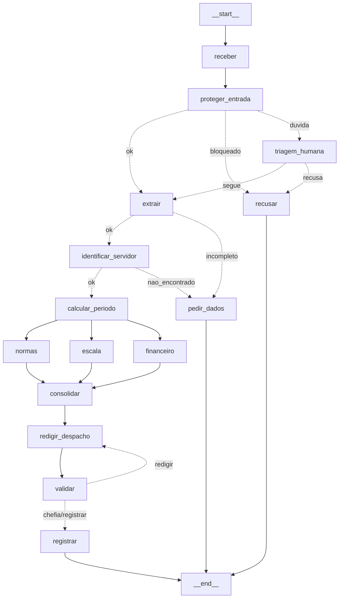

# Entrega: Assistente de Gestão de Pessoas

**Aluno(s):** Thiago Lobo Leite
**Até onde chegou:** (X) Marco mínimo (Etapa 6)  (X) Marco completo (Etapa 9)  (X) Etapas 10–11
**Opcionais e bônus feitos:** (X) 🆕 A  (X) 🆕 B  (X) 🆕 C  ( ) Outro: ______

## Etapa 0: quem verifica cada regra?

| Regra | Tema | Quem verifica (função Python / agente / humano) | Por quê | Onde foi implementada (preencha na Etapa 11) |
|---|---|---|---|---|
| N1 | férias | Função Python | Saldo, até 3 períodos e mínimo de 5 dias são contas | `regras.py` (`violacoes_objetivas`) |
| N2 | férias | Função Python (limite) + agente Financeiro (explica o valor) | `vendidos <= 10`, `gozados + vendidos <= saldo` e `salário/30` são contas; o agente só redige | `regras.py`; agente `Financeiro` (`etapa06_agentes.py`) |
| N3 | férias | Função Python + API de feriados | Dia da semana e véspera de feriado são calendário puro | `ferramentas.inicio_permitido` + `etapa06_regras.py` (pronta) |
| N4 | prazos | Função Python (data real de hoje) | É diferença entre datas | `regras.py`; data de hoje injetada no extrator (`ferramentas.texto_hoje`) |
| N5 | escala | Função Python (limite) + agente Escala (sugere outra data) | 30% com mínimo 1 é conta; sugerir alternativa é interpretação | MCP `consultar_escala` + `regras.py`; agente `Escala` |
| N6 | abono | Função Python | 1 dia útil, saldo de abonos, sem fim de semana/feriado | `etapa06_regras.py` (pronta) |
| N7 | diária | Função Python + API de câmbio + agente Financeiro | Diárias são conta; a cotação vem de fora; o agente explica | MCP `tabela_diarias`, `ferramentas.cotacao_usd_brl`, agente `Financeiro` |
| N8 | aprovação | Python (precisa ou não) + humano (chefia decide) + server (impede autoaprovação) | Regra de segurança: precisa de 3 camadas independentes | `regras.precisa_chefia`; nó `aprovacao_chefia` (Etapa 8); `mcp_rh.registrar_decisao` (Etapa 9) |
| N9 | saúde | Guardrail de entrada (regex de CID + classificador LLM) | Não é regra de negócio: o pedido nem deve entrar | `etapa03_guardrails.py` (`encontrar_dado_sensivel`, `barrar_fora_do_escopo`) |
| N10 | dados | Guardrail de saída (regex no despacho) + instrução do Redator | Protege o que SAI do sistema | Agente `Redator`; validação/guardrail de saída (Etapas 7 e 9) |

## Etapa 11: os 12 casos

Compare **caminho e estado**, não o texto do despacho.

| Caso | Caminho percorrido | Resultado (bloqueado / pediu dados / triagem humana / indeferido / pausou na chefia / registrado + protocolo) | Bateu com o esperado? |
|---|---|---|---|
| C1_abono_simples | TODO (rodar) | | |
| C2_ferias_com_venda | | | |
| C3_dado_de_saude | | | |
| C4_fora_do_escopo | | | |
| C5_sem_matricula | | | |
| C6_conflito_de_escala | | | |
| C7_autoaprovacao | | | |
| C8_idempotencia | | | |
| C9_divergencia | | | |
| C10_zona_cinzenta | | | |
| C11_diaria_exterior | | | |
| C12_inicio_proibido | | | |

## O grafo

## Etapa 4 (pronta): o que eu entendi

- Diferença entre a saída online e a offline: online os feriados vêm da BrasilAPI (fonte `brasilapi`); offline (`FERIADOS_OFFLINE=1`) aparecem 3 tentativas `[retry]` e os feriados vêm do arquivo local (fonte `arquivo_local`). O resultado das regras é o mesmo.
- Por que a espera do retry dobra a cada tentativa: backoff exponencial (0,5 s, 1 s, 2 s...) dá tempo para a API se recuperar e não sobrecarrega um serviço que já está com problema.
- Por que o protocolo é um hash dos campos (e não um número sequencial): o mesmo pedido gera sempre o mesmo protocolo (idempotência); um reenvio (C8) não duplica o registro, sem precisar consultar um contador central.
- O que aconteceria sem o cache de feriados: cada data verificada (dias úteis, N3, retorno) chamaria a API de novo, com dezenas de chamadas por pedido e, offline, dezenas de rodadas de retry.

## Observabilidade (C2)

- Onde o tempo foi gasto: TODO (Etapa 10)
- Tokens totais: ___

## Opcionais (preencha só os que fez)

- 🆕 A: votos e decisão do C9: TODO ; tempo dos 3 extratores em paralelo ___ s, em sequência ___ s
- 🆕 B: saída do `python etapa06_linear.py --governanca`: (a) BARRADO: Coordenador não pode usar consultar_remuneracao (a tool não executou); (b) BARRADO: orçamento de tools estourado (2 de 1)
- 🆕 C: caminho do C10 com a triagem humana (sim e não): TODO (rodar com USAR_TRIAGEM_HUMANA = True)

## Reflexão (até 3 linhas cada)

1. **Quem decide o caminho?** Os quatro, cada um no seu ponto. O **LLM** extrai o pedido e redige o despacho (ex.: transforma "vender 10 dias" em `dias_vendidos=10`). As **regras** em Python decidem se violou (ex.: N3 indefere o C12). O **grafo** decide a ordem e os desvios (ex.: sem matrícula vai a `pedir_dados`). O **humano** decide o que é consequente (ex.: a chefia aprova o C2).
2. **Se o guardrail de entrada falhar, o que impede uma autoaprovação?** As regras objetivas continuam indeferindo (no C7, a N4 barra "a partir de amanhã"), e o **server MCP** só grava um deferimento com o token correto e com o aprovador sendo a chefia cadastrada, nunca o próprio servidor (N8). Quem nega é o server, não o agente.
3. **Por que o nó da chefia não pode gravar nada antes do `interrupt()`?** Porque, na retomada, o nó roda **de novo desde o início**. Tudo o que vier antes do `interrupt()` executaria duas vezes (gravação duplicada, notificação repetida).
4. **MCP, API externa e tool local: o que veio de cada um, e por quê?** **MCP:** cadastro, escala, normas, diárias, remuneração e o registro (dados do órgão, num processo separado, com controle de acesso). **API externa:** feriados (BrasilAPI) e câmbio (Frankfurter), dados públicos que mudam. **Tool local:** cálculos e cotação (`cotacao_dolar`), sem dado sensível. Cada dado fica onde é mais seguro e reutilizável.
5. **O que mudaria para produção?** MCP via HTTP com autenticação forte e segredos num cofre; banco de dados no lugar dos JSON; observabilidade com traces e alertas; testes automatizados dos 12 casos; filas e escalonamento; revisão humana das sugestões de datas; LGPD (retenção e anonimização dos logs).

6. (Só se fez) **🆕 A: votar triplica o custo. Em que pedidos vale a pena?** Em pedidos vagos ou ambíguos ("uns dez dias perto da Páscoa"), em que um erro de data ou de tipo gera registro errado. Em pedidos claros, com datas explícitas (C1, C2), uma extração só basta.
7. (Só se fez) **🆕 B: hook, guardrail e regra no server. Qual a diferença de onde cada um atua?** O **guardrail** atua na **entrada**, antes do agente começar. O **hook** atua **durante** a execução, antes de cada tool ou chamada ao modelo. A **regra no server** atua na **ponta**, dentro do MCP: mesmo que tudo antes falhe, a escrita é negada.
8. (Só se fez) **🆕 C: o que muda quando o humano decide a entrada em vez da saída? Quem é consultado em cada pausa?** Na **entrada**, um **atendente do RH** decide se um pedido ambíguo deve seguir, antes de gastar análise. Na **saída**, a **chefia imediata** aprova ou rejeita o despacho pronto. São pessoas diferentes, em momentos diferentes, e a mesma execução pode pausar duas vezes.
## De onde veio cada parte

| Arquivo / trecho | Exemplo das aulas em que me baseei | O que precisei adaptar |
|---|---|---|
| `etapa01_agente.py` | `aula1/segundo_agente.py`, `exercicios_resolvidos/aula4/ex10_function_tool.py` | Tool lendo o CSV e devolvendo JSON sem o salário |
| `etapa02_extracao.py` (2) | `aula2/agente_output2.py` | Modelo `Pedido` com enums e `Field(description)` |
| `etapa02_extracao.py` (🆕 A) | `aula7/exemplos/08_paralelismo/main.py`, `aula3/agente_parada3.py` | `asyncio.gather` com a MESMA tarefa 3 vezes e votação por maioria |
| `etapa03_guardrails.py` | `aula2/agente_guardrail.py`, `exercicios_resolvidos/aula4/ex11_guardrails.py` | Regex de CPF/CID e classificador com nota; mensagem diferente por motivo |
| `etapa04_ferramentas.py` (pronta) | `aula3/agente_retry*.py`, `aula3/agente_parada3.py`, `aula6/exemplos/11_grafo_real/main.py` | Retry genérico com urllib, plano B local, cache, protocolo com normalização |
| `etapa05_mcp_rh.py` | `aula6/desafio2/mcp_unidades.py`, `aula5/exemplos/03_mcp_parametros/server.py` | 6 tools sempre devolvendo dict; escrita idempotente |
| `etapa05_cliente_mcp.py` | `aula6/desafio2/main.py`, `aula5/exemplos/04_agente_mcp/agente.py` | `chamar_mcp` devolvendo um dict |
| `etapa06_regras.py` (pronta) | `aula6/exemplos/11_grafo_real/main.py` (`avaliar_risco`) | Regras N1–N6 e N8 como tabela de checagens |
| `etapa06_agentes.py` | `aula4/ex03_agente_as_tool.py`, `aula7/exemplos/02_agentes_especializados/main.py` | `as_tool` com `hooks` e `failure_error_function=None` |
| `etapa10_governanca.py` (🆕 B) | `aula3/agente_hook2.py` | Hook que BARRA (permissões e orçamentos) em vez de só imprimir |
| `etapa06_linear.py` | `aula6/exemplos/01_fluxo_linear/main.py` | Os 9 passos encadeados em Python puro |
| `etapa07_grafo.py` (8.4, 9.4) | `aula7/exemplos/06_human_in_the_loop/main.py` (retomar), `aula8/exemplos/05_guardrail_saida` | `retomar` lendo `get_state().next`; despacho trocado por "NÃO REGISTRADO" quando o server nega |
| `etapa05_mcp_rh.py` (9.2, 9.3) | `aula5/exemplos/10_seguranca/server_seguro.py` | token, enum de decisões, N8 (autoaprovação e chefia certa) e auditoria em JSON Lines |
| `etapa10_observabilidade.py`, `etapa10_governanca.py` (10.1–10.3) | `aula3/agente_hook2.py`; solução consultada do colega Tiago (github.com/tiagoASF/atividade-final-multiagentes) | `medido()` por nó, `resumo()` e o hook registrando tool, argumentos e tokens |
| `etapa07_grafo.py` (🆕 C: `proteger_entrada` com duas faixas, `triagem_humana`, `rotear_triagem`) | `aula7/exemplos/06_human_in_the_loop/main.py`; solução consultada do colega Tiago | humano decidindo a ENTRADA, com a orientação anexada ao texto |
